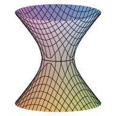
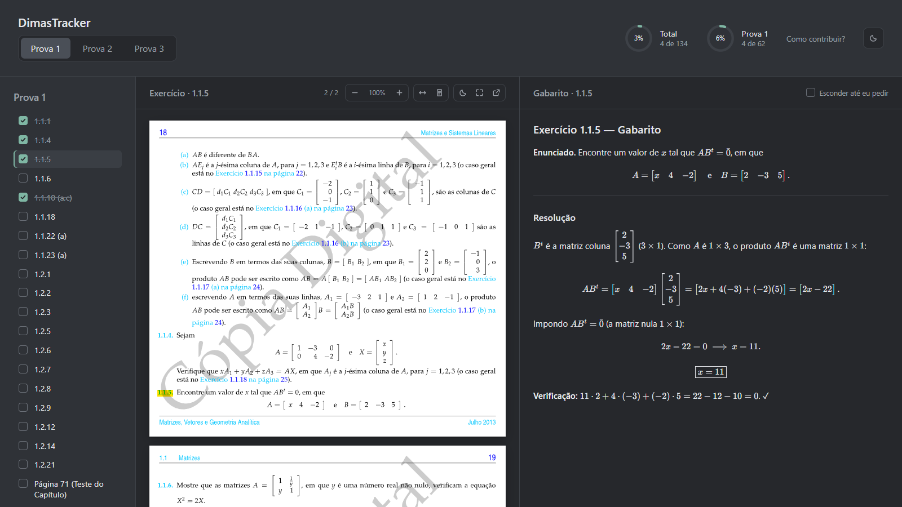
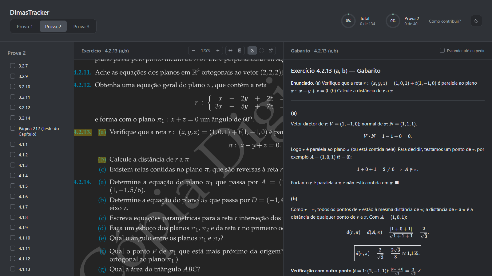
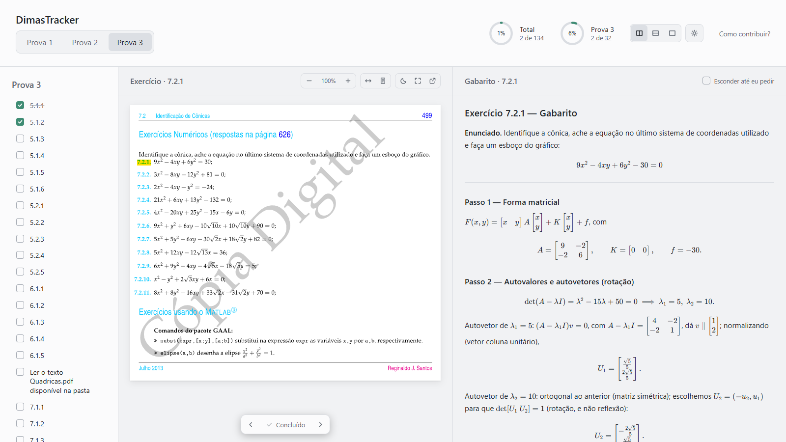

<div align="center">



# DimasTracker

**Acompanhe a lista de exercícios das provas — enunciado e gabarito lado a lado.**

[](https://phbr13.github.io/DimasTracker/)
[](https://phbr13.github.io/DimasTracker/contribuir.html)
[](LICENSE)


[**Abrir o site**](https://phbr13.github.io/DimasTracker/) · [Como contribuir](https://phbr13.github.io/DimasTracker/contribuir.html) · [Reportar um erro](https://github.com/phbr13/DimasTracker/issues/new/choose)

</div>

<br>



## O que é

O DimasTracker reúne, num lugar só, todos os exercícios cobrados nas **três provas** da disciplina: matrizes, sistemas lineares, vetores, retas e planos, cônicas e quádricas. Para cada item da lista você vê o **enunciado original do livro** e um **gabarito resolvido passo a passo**, e vai marcando o que já fez.

- ✅ **Marque o que já resolveu** e acompanhe o progresso por prova e no total
- 📄 **Enunciado do livro** com zoom, modo escuro e marca-textos preservados
- 🧮 **Gabaritos comentados**, com fórmulas bem diagramadas (KaTeX)
- 🙈 **Modo estudo**: esconde o gabarito até você pedir
- 🌗 **Tema claro e escuro**
- ↔️ **Seções redimensionáveis**, com limites para nada ficar apertado
- 💾 **Tudo salvo no navegador**: sem conta e sem servidor

## Funcionalidades

<table>
<tr>
<td width="50%">

### Visualizador de exercícios

As páginas do PDF viram imagens vetoriais nítidas em qualquer zoom.

- **Zoom em direção ao cursor** (Ctrl + rodinha ou pinça no touchpad)
- **Duplo clique** para aproximar num ponto
- **Arrastar** para mover a página
- Ajustar à largura, ver a página inteira e **tela cheia** (<kbd>F</kbd>)
- **Páginas escuras**, que mantêm as cores do marca-texto legíveis

</td>
<td width="50%">



</td>
</tr>
<tr>
<td width="50%">



</td>
<td width="50%">

### Feito para estudar

- **Três provas** com 134 itens no total, cada um com o enunciado e o gabarito
- **Progresso** total e da prova atual, em anéis no cabeçalho
- **Modo estudo**: "Tente resolver antes de conferir"
- **Tema claro** para estudar de dia, **escuro** para a madrugada antes da prova
- Lembra o zoom, o tema, as larguras e o que você marcou

</td>
</tr>
</table>

### Atalhos

| Ação | Como |
|---|---|
| Zoom no exercício | <kbd>Ctrl</kbd> + rodinha · <kbd>Ctrl</kbd> <kbd>+</kbd> / <kbd>Ctrl</kbd> <kbd>−</kbd> |
| Voltar a 100% | <kbd>Ctrl</kbd> <kbd>0</kbd> ou clique no valor do zoom |
| Aproximar num ponto | Duplo clique na página |
| Tela cheia do exercício | <kbd>F</kbd> (com o mouse sobre o exercício) |
| Redimensionar seções | Arraste as linhas entre elas · duplo clique restaura |

## Como usar

**Online:** acesse **[phbr13.github.io/DimasTracker](https://phbr13.github.io/DimasTracker/)**.

**No seu computador:** baixe o projeto e abra o `index.html` com dois cliques. Funciona offline, sem instalar nada.

```bash
git clone https://github.com/phbr13/DimasTracker.git
```

## Como contribuir

Achou um gabarito errado? Resolveu um exercício que ainda não tem solução? **Toda ajuda é bem-vinda**, e várias formas de contribuir não exigem programação.

<a href="https://phbr13.github.io/DimasTracker/contribuir.html"></a>

- 🐛 **Reportar um erro:** [abra uma issue](https://github.com/phbr13/DimasTracker/issues/new/choose) (leva 2 minutos)
- ✍️ **Escrever um gabarito:** em Markdown com fórmulas em LaTeX; uma ferramenta converte para o site
- 📄 **Adicionar um exercício:** o PDF do enunciado e uma linha na lista
- 💻 **Melhorar o site:** HTML, CSS e JavaScript puros, sem frameworks

O passo a passo completo está no **[guia de contribuição](https://phbr13.github.io/DimasTracker/contribuir.html)** (também em [CONTRIBUTING.md](CONTRIBUTING.md)).

## Como funciona

O site é estático, sem etapa de build: funciona abrindo o arquivo direto e no GitHub Pages. O trabalho pesado é feito **antes**, por ferramentas que geram arquivos prontos:

```
exercicios/*.pdf ──▶ ferramentas/gerar-paginas.py ──▶ paginas/*.svg + indice.js
fontes/*.md      ──▶ ferramentas/gerar-gabaritos.mjs ──▶ gabaritos/*.js
```

- **Enunciados:** cada página de PDF vira um SVG vetorial. Os marca-textos são extraídos e redesenhados por cima, com a mesma mistura de cores do PDF.
- **Gabaritos:** Markdown + LaTeX são convertidos com [KaTeX](https://katex.org) e [marked](https://marked.js.org) num `.js` que o site carrega sob demanda. É por isso que funciona até em `file://`, onde o `fetch()` é bloqueado.

<details>
<summary><b>Estrutura de pastas</b></summary>

```
DimasTracker/
├── index.html              página principal
├── script.js               lista de itens e toda a lógica
├── style.css               visual e temas (claro/escuro)
├── contribuir.html/.css/.js  página "Como contribuir?"
├── exercicios/Prova N/     PDFs dos enunciados
├── paginas/                páginas SVG geradas dos PDFs        (gerado)
├── fontes/Prova N/         gabaritos em Markdown
├── gabaritos/Prova N/      gabaritos prontos para o site       (gerado)
├── ferramentas/            scripts de conversão
├── icones/                 ícone do site
├── docs/imagens/           imagens deste README
└── vendor/katex/           fontes e estilo das fórmulas
```

</details>

## Créditos e direitos autorais

- **Código do site:** licença [MIT](LICENSE).
- **Enunciados:** as páginas em `exercicios/` foram tiradas de livros e **pertencem aos seus autores e editoras**. Elas estão aqui só como apoio ao estudo dos alunos da disciplina:
  - *Matrizes, Vetores e Geometria Analítica*, de **Reginaldo J. Santos** (UFMG), distribuído gratuitamente pelo autor
  - *Cálculo*, de **James Stewart** (Cengage Learning): a seção sobre superfícies quádricas, de onde também vem a figura do ícone

  Se você é detentor de direitos e quer que algum material seja removido, [abra uma issue](https://github.com/phbr13/DimasTracker/issues/new/choose) e ele será retirado.
- **Fórmulas:** renderizadas com [KaTeX](https://katex.org) (MIT).
